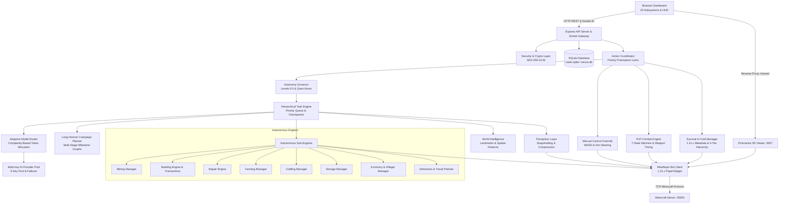

# Minecraft Nexus AI — System Architecture

Minecraft Nexus AI is an enterprise-grade autonomous player system designed for Minecraft Java Edition 1.21.x (Paper, Purpur, Spigot).

---

## 1. High-Level Architecture Diagram

---

## 2. Core Subsystems

### 2.1 Storage & Security Layer (`src/storage/`)
- **`crypto.ts`**: AES-256-GCM cipher using a 32-byte master key stored in `NEXUS_MASTER_KEY` or automatically persisted to `data/.master.key`. Redacts credentials before exposing to logs or UI.
- **`database.ts`**: Implements repositories (`CredentialRepo`, `TaskRepo`, `BlueprintRepo`, `LandmarkRepo`, `PermissionRepo`, `AuditRepo`, `AppSettingsRepo`, `TaskLeaseRepo`) on top of Node.js 22+ built-in `node:sqlite` (`DatabaseSync`).

### 2.2 AI Reasoning & Adaptive Routing (`src/ai/`)
- **`model-router.ts`**: Routes tasks based on computational complexity (low, medium, high, reasoning) to the most cost-effective provider in the pool.
- **`provider-pool.ts`**:
  - Manages up to 5 encrypted API credentials.
  - Supports OpenRouter, OpenAI, Groq, Together AI, Fireworks AI, and Custom OpenAI-compatible endpoints.
  - Rate limit detection (HTTP 429 Retry-After) and automatic failover to healthy pool members.
  - Groq 404 model auto-downgrade (`llama-3.3-70b-versatile` ↔ `llama-3.1-8b-instant`).
  - Exponential backoff with jitter and circuit breaker pattern.
- **`intent-parser.ts`**:
  - Validates player roles (admin, trusted, visitor, blocked).
  - Sanitizes chat input against prompt injection techniques.
  - Maps natural language requests into structured intents (`mine`, `build`, `follow`, `harvest`, `stop`, `status`).

### 2.3 Authoritative Coordination & Autonomy (`src/engine/`)
- **`action-coordinator.ts`**: Authoritative priority lock manager preventing conflicting movements or simultaneous tool actions. Priority hierarchy:
  1. `EMERGENCY` (Disengagement, lava escape)
  2. `MANUAL_OVERRIDE` (Player WASD controls)
  3. `COMBAT_RECOVERY` (Tactical retreat, healing)
  4. `COMBAT_ENGAGE` (PVP/PVE strikes)
  5. `ROUTINE_EAT` (Safe biological eating cycle)
  6. `TASK_EXECUTION` (Mining, farming, building)
- **`autonomy-manager.ts`**: Enforces Autonomy Levels 0 to 5 (`OBSERVE` through `EXPERT MODE`), quiet hours, and maximum unattended operating hours.
- **`capability-registry.ts`**: Registry of 16 granular bot capabilities with verified operational statuses, error rates, and known limitations.

### 2.4 Combat & Biological Maintenance (`src/engine/`)
- **`combat-manager.ts`**:
  - PvP strictly disabled by default.
  - Configurable modes: `disabled`, `defensive`, `approved_duel`, `owner_authorized`, `practice`, `custom`.
  - Deterministic 7-state machine: `IDLE` → `TARGET_VALIDATION` → `PREPARATION` → `ENGAGE` → `DEFEND_OR_REPOSITION` → `RECOVERY` → `RESUME_OR_DISENGAGE`.
  - 1.21.x attack speed weapon cooldown (~625ms for swords, 1250ms for axes) and offhand shield blocking.
- **`food-manager.ts`**:
  - Minecraft 1.21.x consumable metadata catalog (`foodPoints`, `saturation`).
  - Intelligent scoring formula penalizing harmful foods and safeguarding rare consumables.
  - 10-step safe eating cycle preventing tool drops and handling hand swaps.
  - 20-minute pre-trip expedition food forecasting.
- **`survival-manager.ts`**:
  - Enforces 4-tier survival hierarchy (Critical, Combat Recovery, Routine Hunger, Long-term Prep).
  - Dynamic armor equipping and environmental hazard avoidance.

### 2.5 World Intelligence, Campaigns & Travel (`src/engine/`)
- **`world-intelligence.ts`**: Persistent spatial memory indexing landmarks, points of interest, resource sites, freshness TTL, and Euclidean distance sorting.
- **`campaign-planner.ts`**: Long-horizon campaign manager structuring complex SMP progression into staged milestone graphs with automated retry budgets.
- **`travel-planner.ts`**: Pre-travel readiness validation and Overworld ↔ Nether 8:1 coordinate conversions.
- **`economy-manager.ts`**: Villager trade inspection, economic cost evaluation, and rare resource protection.
- **`build-transactions.ts`**: Full block journaling during blueprint construction with conflict-aware rollback capabilities.
- **`multi-agent.ts`**: Distributed task lease manager with TTL heartbeats preventing multi-instance collisions.
- **`event-timeline.ts`**: Unified flight recorder and sanitized diagnostic bundle exporter redacting all player IPs and secrets.
- **`vision-adapter.ts`**: Rate-limited, on-demand scene snapshot generator with visual estimation disclaimer.

### 2.6 Autonomous Gameplay Engines (`src/engine/`)
- **`perception.ts`**: Extracts coordinates, velocity, health, food, inventory items, nearby hostiles, and dropped items into a compact, compressed world representation.
- **`task-manager.ts`**: Priority task queue with checkpointing, pause/resume, and cancellation support.
- **`mining-manager.ts`**: Mines blocks with optimal tool selection, pathfinding navigation, and drop collection.
- **`building-engine.ts`**: Analyzes blueprints, calculates material manifests, and places blocks bottom-up with transaction logging.
- **`repair-engine.ts`**: Scans blueprint coordinates against the live world and places missing blocks.
- **`farming-manager.ts`**: Locates mature crops (wheat, carrots, potatoes, beetroots), harvests them, and replants seeds.
- **`storage-manager.ts`**: Identifies nearby chests and deposits items by category (`ores`, `blocks`, `drops`, `all_except_hotbar`).

### 2.7 Bot & 3D Viewer Subsystem (`src/bot/`, `src/viewer/`)
- **`connection.ts`**: Mineflayer lifecycle management, Paper/Spigot version negotiation, and resilient auto-reconnect.
- **`manual-control.ts`**: WASD movement and jump controls that claim exclusive priority 2 locks to suspend AI pathfinding gracefully.
- **`viewer-manager.ts`**: Runs the Prismarine 3D viewer on internal port `3007`, reverse-proxied through Express at `/viewer/`.

### 2.8 API & Real-Time Gateway (`src/api/`, `src/`)
- **`server.ts`**: Express REST API endpoints covering all 20 dashboard modules, session authentication, and Socket.IO bidirectional telemetry.
- **`index.ts`**: Main entrypoint orchestrating database boot, default blueprint seeding, server initialization, and bot connection.
