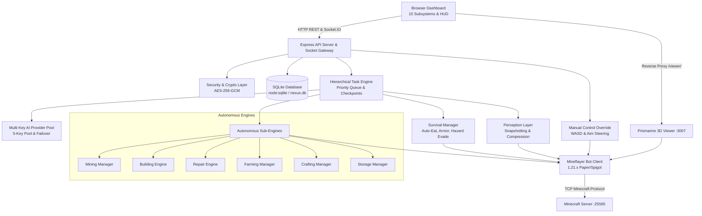

# Minecraft Nexus AI — System Architecture

Minecraft Nexus AI is an enterprise-grade autonomous player system designed for Minecraft Java Edition 1.21.x (Paper, Purpur, Spigot).

---

## 1. High-Level Architecture Diagram

---

## 2. Core Subsystems

### 2.1 Storage & Security Layer (`src/storage/`)
- **`crypto.ts`**: AES-256-GCM cipher using a 32-byte master key stored in `NEXUS_MASTER_KEY` or automatically persisted to `data/.master.key`. Redacts credentials before exposing to logs or UI.
- **`database.ts`**: Implements repositories (`CredentialRepo`, `TaskRepo`, `BlueprintRepo`, `LandmarkRepo`, `PermissionRepo`, `AuditRepo`, `AppSettingsRepo`) on top of Node.js 22+ built-in `node:sqlite` (`DatabaseSync`).

### 2.2 AI Reasoning & Multi-Key Pool (`src/ai/`)
- **`provider-pool.ts`**:
  - Manages up to 5 encrypted API credentials.
  - Supports OpenRouter, OpenAI, Groq, Together AI, Fireworks AI, and Custom OpenAI-compatible endpoints.
  - Rate limit detection (HTTP 429 Retry-After) and automatic failover to healthy pool members.
  - Groq 404 model auto-downgrade (`llama-3.3-70b-versatile` ↔ `llama-3.1-8b-instant`).
  - Exponential backoff with jitter and circuit breaker pattern.
- **`intent-parser.ts`**:
  - Validates player roles (admin, trusted, visitor, blocked).
  - Sanitizes chat input against prompt injection techniques.
  - Maps natural language requests into structured intents (`mine`, `build`, `follow`, `harvest`, `stop`, `status`).

### 2.3 Autonomous Gameplay Engines (`src/engine/`)
- **`perception.ts`**: Extracts coordinates, velocity, health, food, inventory items, nearby hostiles, and dropped items into a compact, compressed world representation.
- **`survival-manager.ts`**:
  - Auto-eats when hunger drops below 16.
  - Auto-equips best armor (helmets, chestplates, leggings, boots).
  - Retreats from hostile mobs when health is critically low.
- **`task-manager.ts`**: Priority task queue with checkpointing, pause/resume, and cancellation support.
- **`mining-manager.ts`**: Mines blocks with optimal tool selection, pathfinding navigation, and drop collection.
- **`building-engine.ts`**: Analyzes blueprints, calculates material manifests, and places blocks bottom-up.
- **`repair-engine.ts`**: Scans blueprint coordinates against the live world and places missing blocks.
- **`farming-manager.ts`**: Locates mature crops (wheat, carrots, potatoes, beetroots), harvests them, and replants seeds.
- **`storage-manager.ts`**: Identifies nearby chests and deposits items by category (`ores`, `blocks`, `drops`, `all_except_hotbar`).

### 2.4 Bot & 3D Viewer Subsystem (`src/bot/`, `src/viewer/`)
- **`connection.ts`**: Mineflayer lifecycle management, Paper/Spigot version negotiation, and resilient auto-reconnect.
- **`manual-control.ts`**: WASD movement and jump controls that temporarily suspend AI pathfinding to prevent input contention.
- **`viewer-manager.ts`**: Runs the Prismarine 3D viewer on internal port `3007`, proxied through the Express API at `/viewer/`.

### 2.5 API & Real-Time Gateway (`src/api/`, `src/`)
- **`server.ts`**: Express REST API endpoints for all 15 dashboard modules, session authentication, and Socket.IO bidirectional telemetry.
- **`index.ts`**: Main entrypoint orchestrating database boot, default blueprint seeding, server initialization, and bot connection.
