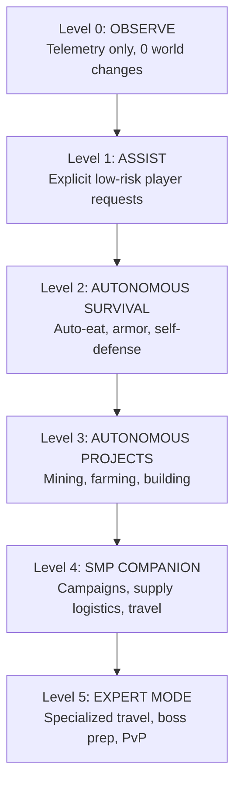

# 🌍 Autonomy Levels, Long-Horizon Campaigns & World Intelligence

Minecraft Nexus AI expands autonomous agent capabilities with a governed 6-tier autonomy framework, multi-stage campaign graphs, persistent spatial memory, conflict-safe construction rollbacks, and multi-agent task leasing.

---

## 1. Six-Tier Autonomy Governor

The Autonomy Governor (`src/engine/autonomy-manager.ts`) acts as the central gatekeeper for all bot actions, guaranteeing the agent never exceeds its owner-configured permissions.



| Level | Name | Permissions & Allowed Operations | Safety Constraints |
|---|---|---|---|
| **0** | `OBSERVE` | Sensory observation, chat read, telemetry export, navigation to safe viewpoints. | **Zero block breaking, placing, attacking, or chest interaction permitted.** |
| **1** | `ASSIST` | Follow player, retrieve dropped items, display inventory, chat response. | Executes only upon explicit, authenticated player request. |
| **2** | `AUTONOMOUS SURVIVAL` | Self-eating, armor equipping, mob defense, returning to home shelter at night. | Cannot alter player-built structures or initiate mining projects. |
| **3** | `AUTONOMOUS PROJECTS` | Autonomous tree chopping, ore mining, crop harvesting, blueprint building. | Bounded by configured work zones and protected radius. |
| **4** | `SMP COMPANION` | Multi-stage campaign execution, resource stocking, safe route traversal. | Respects quiet hours and max unattended runtime limits. |
| **5** | `EXPERT MODE` | Nether expeditions, portal construction, approved dueling, high-risk exploration. | Requires owner authorization and strict backup checkpoints. |

### 1.1 Operating Schedules & Quiet Hours
- **Quiet Hours**: Configurable time window (e.g., `23:00` - `07:00`) where autonomous task execution is suspended, returning the bot to a designated home landmark.
- **Max Unattended Operating Limit**: Automatic safety timeout (default: 4 hours) after which autonomy automatically falls back to Level 1 (`ASSIST`) unless renewed by an authorized player.

---

## 2. Long-Horizon Campaign Planner

Complex survival milestones cannot be solved by single monolithic tasks. The Campaign Planner (`src/engine/campaign-planner.ts`) organizes objectives into directed acyclic dependency graphs (DAGs).

### 2.1 Default Campaign Templates

1. **Starter Base Establishment**:
   - `Stage 1`: Gather 64 oak logs and craft crafting table + chests.
   - `Stage 2`: Mine 32 cobblestone and craft stone pickaxe/axe.
   - `Stage 3`: Clear 10x10 area and construct starter shelter blueprint.
   - `Stage 4`: Place bed, crafting table, and register `home` landmark.
2. **Renewable Food Supply**:
   - `Stage 1`: Gather seeds and craft stone hoe.
   - `Stage 2`: Till 9x9 farmland with central water source.
   - `Stage 3`: Plant wheat and potatoes.
   - `Stage 4`: Establish proactive harvest loop.
3. **Storage Network Organization**:
   - `Stage 1`: Construct chest array.
   - `Stage 2`: Scan surrounding containers and index item categories.
   - `Stage 3`: Consolidate and sort inventory into categorized chests.

### 2.2 Stage Lifecycle & Checkpoints
- Each stage maintains states: `pending` → `in_progress` → `completed` (or `blocked` / `failed`).
- **Retry Budget**: Stages allow up to 3 automated recovery attempts before pausing the campaign and reporting the blocker cause to the dashboard.
- **Pause & Resume**: Campaigns can be suspended instantly from the dashboard or in-game chat and resumed without losing completed milestones.

---

## 3. World Intelligence & Dimension Travel

### 3.1 Persistent Spatial Memory
The World Intelligence engine (`src/engine/world-intelligence.ts`) records landmarks and points of interest into the local database:
- **Categories**: `home`, `farm`, `mine`, `storage`, `portal`, `village`, `danger_zone`.
- **Freshness & TTL**: Every observation tracks a timestamp. Observations older than 2 hours are marked stale until re-verified.
- **Euclidean & Manhattan Distance Calculations**: Automatically selects the closest resource cache or sanctuary during emergency retreats.

### 3.2 Dimension Travel & Coordinate Math
- **Nether 8:1 Ratio Conversion**:
  $$X_{\text{nether}} = \lfloor X_{\text{overworld}} / 8 \rfloor, \quad Z_{\text{nether}} = \lfloor Z_{\text{overworld}} / 8 \rfloor$$
  $$X_{\text{overworld}} = X_{\text{nether}} \times 8, \quad Z_{\text{overworld}} = Z_{\text{nether}} \times 8$$
- **Pre-Travel Readiness Checklist**:
  - Minimum 32 standard food items or 16 golden carrots.
  - Pickaxe durability > 50%.
  - Full armor equipped.
  - Water bucket (in Overworld) or fire resistance potion (in Nether).
  - Minimum 16 building blocks (cobblestone) for bridging/barricades.

---

## 4. Build Transactions & Conflict-Safe Rollback

To ensure construction tasks do not damage SMP builds or conflict with human players, every block placed by the Building Engine is tracked in an atomic transaction journal (`src/engine/build-transactions.ts`).

### 4.1 Transaction Logging
When placing a structure or repairing a blueprint:
```json
{
  "transactionId": "tx_1728829000_abc",
  "blueprintId": "starter_cabin",
  "startTime": 1728829000000,
  "changes": [
    {
      "pos": { "x": 100, "y": 64, "z": 200 },
      "previousBlock": "air",
      "placedBlock": "oak_planks",
      "timestamp": 1728829005000
    }
  ]
}
```

### 4.2 Conflict Detection Before Rollback
Before reverting any block change:
1. The engine inspects the current live world block at `pos`.
2. **Conflict Check**: If the current block differs from `placedBlock` (meaning a human player modified, mined, or decorated the block after the bot placed it), the rollback **halts** for that position and logs an external player modification conflict.
3. Preserves human player builds while safely undoing unintended bot placements.

---

## 5. Multi-Agent Coordination & Leases

For SMP servers deploying multiple autonomous bots or worker instances, the system provides distributed task leasing (`src/engine/multi-agent.ts`):
- **Task Leases**: Tasks are locked with a lease owner ID and TTL (e.g. 60 seconds).
- **Lease Heartbeat**: The executing bot refreshes its lease every 15 seconds.
- **Failover**: If a bot disconnects or crashes, expired leases are released automatically, allowing a secondary bot to pick up the task from the last saved checkpoint.

---

## 6. API Reference

| Method | Endpoint | Description |
|---|---|---|
| `GET` | `/api/autonomy/config` | Returns active autonomy level (0-5), schedule, and capabilities. |
| `POST` | `/api/autonomy/level` | Changes the bot's autonomy level (requires auth). |
| `GET` | `/api/campaigns` | Lists all long-horizon campaigns and current stages. |
| `POST` | `/api/campaigns/create` | Instantiates a new campaign from template. |
| `POST` | `/api/campaigns/:id/advance` | Advances or retries a campaign stage. |
| `GET` | `/api/world/landmarks` | Returns known landmarks and distance to bot. |
| `POST` | `/api/world/landmarks` | Registers a new landmark with coordinates and category. |
| `GET` | `/api/travel/checklist` | Evaluates travel readiness checklist for target dimension. |
| `GET` | `/api/transactions` | Lists recorded build transactions. |
| `POST` | `/api/transactions/:id/rollback` | Executes a conflict-safe rollback on a transaction. |
