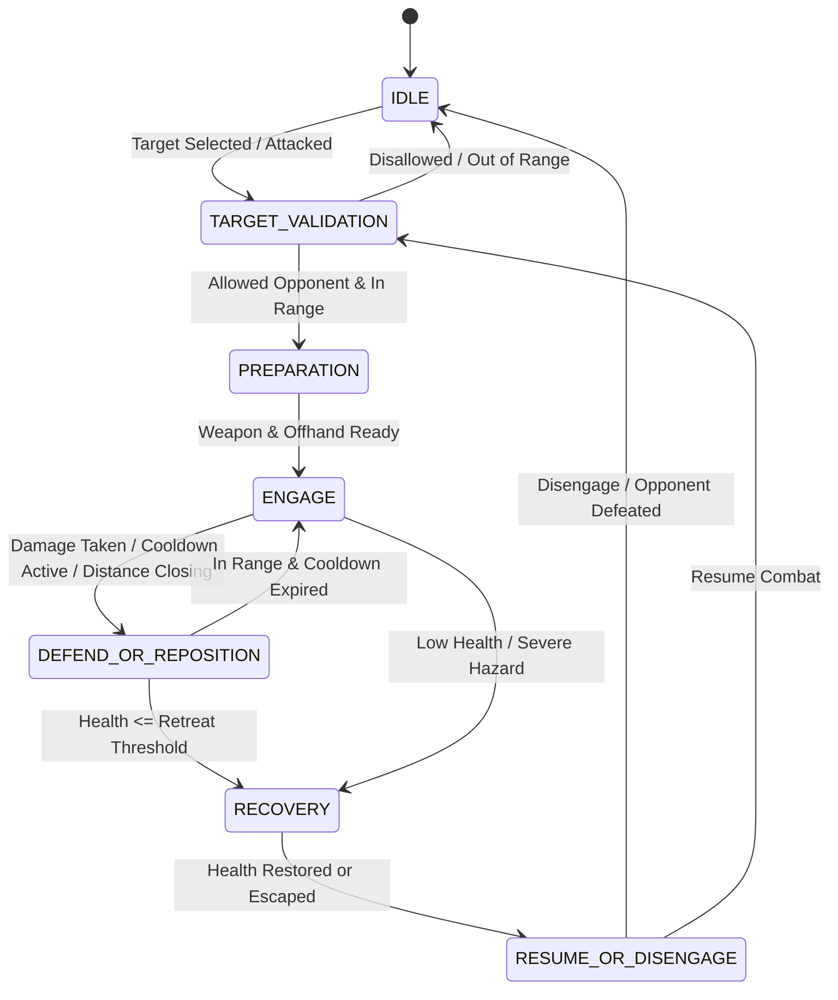
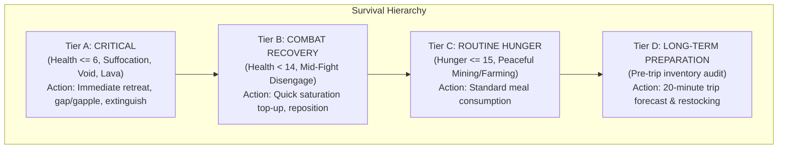

# ⚔️ Nexus Combat AI & Smart Food/Survival System

Minecraft Nexus AI incorporates a deterministic, safety-bounded PvP combat engine and an intelligent 1.21.x survival/hunger manager. This system ensures high-efficiency combat execution and biological maintenance while strictly enforcing player authorization and preventing accidental PvP or resource waste.

---

## 1. Advanced PvP Combat AI Subsystem

### 1.1 Configurable Combat Modes

PvP combat is strictly **disabled by default**. Even in single-player or private SMP environments, the bot will never attack players unless explicitly enabled through authenticated dashboard configuration.

| Mode | Behavior | Safety Boundaries |
|---|---|---|
| `disabled` | Never attacks players under any circumstances. *(Default)* | Absolute safety lock. Chat cannot override. |
| `defensive` | Only defends itself when attacked by an entity/player. | Targets only the specific aggressor if permitted. |
| `approved_duel` | Engages solely players present in the `allowedOpponents` list. | Ceases attack immediately upon opponent surrender or disengagement. |
| `owner_authorized`| Only engages targets explicitly approved by the server owner/admin. | Requires admin permission level. |
| `practice` | Test combat decisions in a controlled arena environment. | Non-lethal disengagement thresholds enforced. |
| `custom` | Fine-tuned engagement parameters defined by dashboard settings. | Subject to authoritative action locks. |

### 1.2 Deterministic 7-State Combat Machine

To avoid unpredictable LLM hallucinations during combat ticks, combat decisions are handled by a high-frequency, deterministic state machine (`src/engine/combat-manager.ts`):

1. **`IDLE`**: Scans surroundings, monitors damage events, stays in standby.
2. **`TARGET_VALIDATION`**: Validates the candidate against the security allowlist, line-of-sight, and distance constraints.
3. **`PREPARATION`**: Equips the highest-damage weapon in mainhand and shield in offhand. Verifies durability.
4. **`ENGAGE`**: Faces the target precisely and strikes respecting the 1.21.x attack speed cooldown (~625ms for swords, 1250ms for axes).
5. **`DEFEND_OR_REPOSITION`**: Raises shield during opponent attack animations, strafes or backs up during weapon cooldown.
6. **`RECOVERY`**: Triggers tactical disengagement when health drops below the safety threshold (`retreatHealthThreshold`, default: 6.0 HP / 3 hearts).
7. **`RESUME_OR_DISENGAGE`**: Evaluates whether the threat has ended or if combat can safely be resumed.

### 1.3 Attack Cooldown & Shield Mechanics
- **Weapon Cooldown Synchronization**: Prevents spam-clicking which deals negligible damage in Minecraft 1.9+ / 1.21.x. Uses dynamic delays:
  - Swords: ~625ms delay (1.6 attack speed).
  - Axes: ~1,250ms delay (0.8 attack speed).
- **Offhand Shield**: Automatically equips a shield in the offhand slot (`offhand`) and activates blocking (`useItem`) when projectiles or incoming player swings are detected.
- **Emergency Retreat**: When bot health <= 6 HP, pre-empts all engagement tasks, grants lock priority to `RECOVERY`, sprints away from the target vector, and navigates toward safe cover or landmarks.

---

## 2. Smart Food & Hunger System

The Smart Food System (`src/engine/food-manager.ts`) replaces naive eating with real 1.21.x Minecraft metadata, dynamic nutritional scoring, and safe eating execution.

### 2.1 Food Item Metadata Catalog (1.21.x)

Every consumable item is indexed with its exact Minecraft 1.21.x food points and saturation:

| Item | Food Points | Saturation | Saturation Ratio | Category / Notes |
|---|---|---|---|---|
| `golden_carrot` | 6 | 14.4 | 2.4 | Optimal combat & saturation food |
| `cooked_porkchop` | 8 | 12.8 | 1.6 | High-tier meat |
| `cooked_beef` (steak) | 8 | 12.8 | 1.6 | High-tier meat |
| `cooked_mutton` | 6 | 9.6 | 1.6 | Standard meat |
| `cooked_salmon` | 6 | 9.6 | 1.6 | Standard fish |
| `baked_potato` | 5 | 6.0 | 1.2 | Sustainable agricultural food |
| `bread` | 5 | 6.0 | 1.2 | Routine wheat food |
| `apple` | 4 | 2.4 | 0.6 | Low saturation forage |
| `sweet_berries` | 2 | 0.4 | 0.2 | Low tier forage |
| `golden_apple` | 4 | 9.6 | 2.4 | **Protected Rare**: Emergency health only |
| `enchanted_golden_apple`| 4 | 9.6 | 2.4 | **Protected Rare**: Critical survival only |

### 2.2 Intelligent Food Scoring

The bot ranks its inventory items using a weighted formula:

$$\text{Score} = (\text{Saturation} \times 1.5) + \text{FoodPoints} - \text{Penalty}$$

- **Banned / Poisonous Foods Filter**: Rotten Flesh, Pufferfish, Spider Eyes, Poisonous Potatoes, and Raw Chicken receive heavy penalties or are banned from routine consumption.
- **Rare Item Protection**: Golden Apples and Enchanted Golden Apples are preserved unless the bot enters Priority A (Critical Survival) state.
- **Efficiency Match**: Prevents wasting 8-point cooked beef when only 2 hunger points are missing; selects the best food that minimizes wasted nutritional value.

### 2.3 10-Step Safe Eating Controller

Eating in Minecraft locks player actions for 1.61 seconds (32 ticks). The bot executes a deterministic 10-step eating cycle:
1. **Safety Pre-Check**: Checks distance to nearest hostiles.
2. **Current Tool Snapshot**: Caches the active held item.
3. **Item Selection**: Selects the highest-scored eligible food from inventory.
4. **Hand Slot Assignment**: Equips food to main hand or offhand.
5. **Action Lock Acquisition**: Claims exclusive `ActionCoordinator` priority 3 (`EAT`).
6. **Activation**: Invokes `bot.activateItem()`.
7. **Tick Wait**: Waits for completion (~1,650ms).
8. **Verification**: Checks if hunger/saturation increased or item count decremented.
9. **Tool Restoration**: Restores previous weapon, pickaxe, or tool.
10. **Lock Release**: Releases action lock for pending tasks.

---

## 3. Four-Tier Survival Priority Hierarchy

The Survival Manager (`src/engine/survival-manager.ts`) enforces a strict priority triage:

### 3.1 Pre-Trip Food Forecasting
Before departing on mining expeditions, building projects, or travel over 100 blocks, the bot calculates a 20-minute food forecast:
- **Base Consumption**: ~1 hunger point per minute of steady movement.
- **Activity Multiplier**: 1.5x for mining (exhaustion from breaking blocks), 2.0x for combat and sprinting.
- **Forecast Threshold**: Requires at least 20 food points of stored nutritional value. If inventory is below threshold, raises a warning or halts expedition departure.

---

## 4. API Endpoints

| Method | Endpoint | Description |
|---|---|---|
| `GET` | `/api/combat/status` | Returns active combat mode, target, weapon, health, and recent events. |
| `POST` | `/api/combat/mode` | Updates combat mode (`disabled`, `defensive`, `approved_duel`, etc.). |
| `POST` | `/api/combat/allowlist` | Adds or removes players from `allowedOpponents`. |
| `POST` | `/api/combat/retreat` | Triggers immediate emergency combat retreat. |
| `GET` | `/api/survival/status` | Returns food items, saturation, active priority tier, and pre-trip forecast. |
| `POST` | `/api/survival/eat` | Forces a manual safe eating cycle. |
