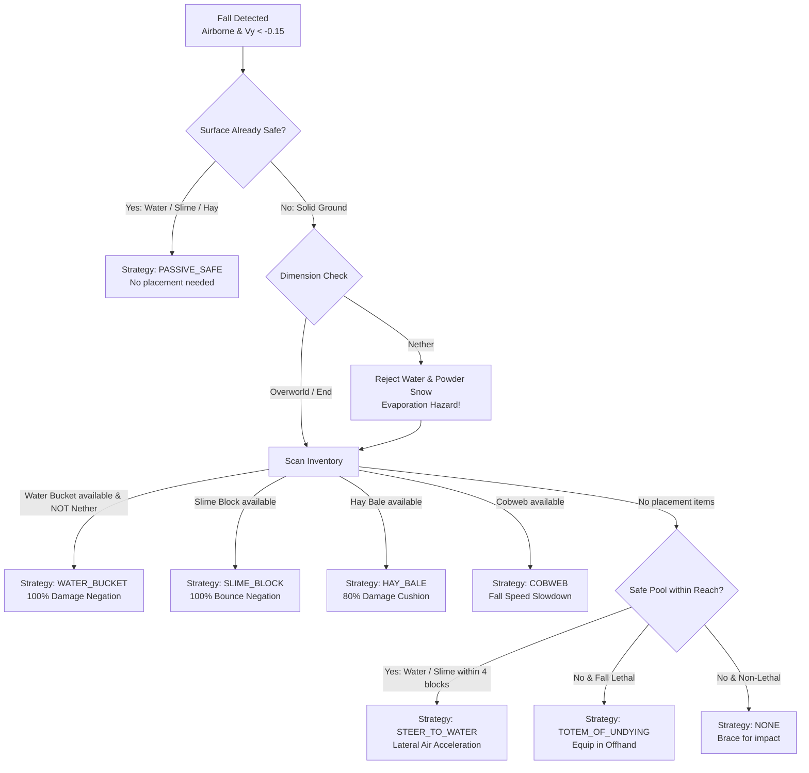

# 🪂 MLG Clutch & Fall-Recovery System

Minecraft Nexus AI incorporates a deterministic, 20 TPS physics-driven **MLG Clutch & Fall-Recovery System** (`src/engine/clutch-manager.ts`) designed for Minecraft Java Edition 1.21.x (Paper/Spigot).

Because falls are strictly time-critical (a 20-block drop takes $\approx 1.2$ seconds), this system operates entirely on **local deterministic physics and state machines**, completely bypassing LLM request latency.

---

## 1. 20 TPS Fall Perception & Detection

Every 50ms (20 times per second), the bot evaluates its physical flight dynamics during Mineflayer's `physicsTick`:

1. **Airborne State Detection**:
   $$\text{isFalling} \iff (\neg\text{onGround}) \land (v_y < -0.15\text{ m/tick})$$
2. **Downward Raycasting**:
   Scans down the column from current position $(X, Y, Z)$ to determine the first non-air block below.
   - Identifies surface block coordinates $(X, Y_{\text{surface}}, Z)$ and surface type (`stone`, `water`, `slime_block`, `hay_block`, `cobweb`, etc.).
3. **Java Edition Terminal Velocity Simulation**:
   Simulates step-by-step landing trajectory using 1.21.x drag and gravity coefficients:
   $$v_{y, t+1} = (v_{y, t} - 0.08) \times 0.98$$
   $$y_{t+1} = y_t + v_{y, t+1}$$
   - Calculates remaining ticks to impact $T_{\text{ticks}}$ and estimated landing time $T_{\text{impact}} = T_{\text{ticks}} \times 50\text{ ms}$.
   - Terminal velocity asymptotes at approximately $-3.92\text{ m/tick}$ ($\approx -78.4\text{ m/s}$).
4. **Predicted Fall Damage**:
   $$\text{Damage (HP)} = \max(0, \lfloor H_{\text{fall}} \rfloor - 3)$$
   - Falls $\le 3\text{m}$: 0 HP damage.
   - Fall 10m: 7 HP damage (3.5 hearts).
   - Fall 20m: 17 HP damage (8.5 hearts).
   - Fall 30m: 27 HP damage (Lethal without mitigation).

---

## 2. Multi-Strategy Selection & Dimension Constraints

The clutch selector prioritizes items based on environment, inventory availability, and dimension physics:

### 2.1 Dimension-Specific Rules
- **The Nether (`minecraft:the_nether`)**:
  - **Water buckets immediately evaporate** upon placement, playing a steam particle effect and failing to cushion the fall.
  - The engine strictly prohibits `water_bucket` and `powder_snow_bucket` in the Nether.
  - Automatically falls back to `slime_block`, `hay_block`, `cobweb`, or `totem_of_undying`.
- **The End (`minecraft:the_end`)**:
  - Water works normally.
  - If falling into the Void ($Y < 0$ with no surface below), logs `VOID_FALL` and prepares recovery.

---

## 3. High-Priority Action Lock & Execution

To prevent PvP, WASD keyboard inputs, or pathfinding from corrupting the clutch aim during the final fraction of a second:

1. **Lock Preemption**:
   - Acquires `ActionCoordinator.PRIORITY_EMERGENCY` (Priority 1) with owner `"mlg_clutch"`.
   - Preempts Manual Control (Priority 2), Combat (Priority 4), and Routine Tasks (Priority 6).
2. **Input Cleared**:
   - `bot.clearControlStates()` clears forward/back/jump inputs.
   - `bot.pathfinder.setGoal(null)` halts all pathfinder nodes.
3. **Instant Aim Downwards**:
   - `bot.look(yaw, -Math.PI / 2, true)` aligns pitch to $-90^\circ$ (pointing directly down at the impact block).
4. **Trigger Window**:
   - Executes when distance $H \le 3.4\text{ blocks}$ OR estimated time to impact $\le 160\text{ ms}$.
   - Equips clutch item to main hand (or Totem of Undying to off-hand).
   - Executes placement via `bot.placeBlock` or `bot.activateItem`.
5. **Post-Clutch Water Recovery**:
   - When the bot lands safely in the placed water, waits $200\text{ ms}$ for fall damage negation, equips the empty `bucket`, and uses it to re-scoop the water block.
   - Prevents flooding the player base or losing the water bucket.
6. **Lock Release**:
   - Releases the `ActionCoordinator` emergency lock and restores previous held items.

---

## 4. Configurable Modes

| Mode | Behavior | Use Case |
|---|---|---|
| `disabled` | Never attempts clutches or interferes with falling. | Manual play or creative testing. |
| `practice` | Active in all falls $\ge 4\text{m}$. Records execution timing offsets ($\Delta\text{ms}$) and measures placement latency. | Training arenas and drill verification. |
| `survival_emergency` | Only activates on unexpected falls $\ge 4\text{m}$ (or lethal falls). Preempts all other systems. | **Production SMP Survival** *(Default)* |

---

## 5. Local Test Arena

Nexus AI includes a built-in automated test arena endpoint (`POST /api/clutch/arena/test`) and dashboard control panel:
- **Configurable Fall Heights**: 5m, 10m, 20m, 30m, 50m.
- **Configurable Landing Surfaces**:
  - `stone`: Tests real-time water-bucket clutch and re-scoop.
  - `water`: Tests passive safe landing without wasting items.
  - `hay_block`: Tests 80% damage reduction cushioning.
  - `slime_block`: Tests 100% bounce cushion.
  - `netherrack`: Tests Nether restriction handling and evaporation prevention.

---

## 6. Known Limitations & Realities

> [!NOTE]
> MLG clutching in Minecraft is subject to server-side physics and network conditions:
> 1. **Network Ping & Jitter**: If server latency $> 150\text{ms}$ or tick processing drops below 18 TPS, client placement packets may arrive after server fall damage calculation.
> 2. **Non-Flat Terrain**: Half-slabs, stairs, fences, signs, and torches do not have full top block faces and will prevent water or cushion placement.
> 3. **Paper/Spigot Anti-Cheat Plugins**: Strict anti-fast-click or anti-fast-place plugins may throttle high-frequency place packets. Trigger reach is tuned to 3.4 blocks to stay within standard vanilla reach limits.
